# Database CDC Architecture Specification

## Section 1: Problem Statement

In modern distributed microservices and decoupled enterprise data systems, Change Data Capture (CDC) streams are the lifeblood of real-time state synchronization and operational data warehousing. However, asynchronous network transport, message broker partition rebalancing (e.g., Kafka partition reassignments), distributed database replication lag, and out-of-order retries introduce substantial challenges: events arrive disordered, duplicated, and interleaved. When a stream contains thousands of updates and deletes across records, standard database views cannot accurately reconstruct the source state without state reconciliation. The problem addressed by this architecture is the deterministic reconstruction of the true, point-in-time latest state of every record from an unordered, out-of-sequence stream of 100,000 CDC log records containing `INSERT`, `UPDATE`, and `DELETE` operations, while guaranteeing zero duplicate primary keys, correct tombstone purge, and sub-second analytical queryability.

```mermaid
flowchart LR
    subgraph Stream ["CDC Event Stream"]
        direction TB
        E1["user_1 | INSERT | 10:00 | txn_01"]
        E2["user_1 | UPDATE | 12:00 | txn_03"]
        E3["user_1 | UPDATE | 11:00 | txn_02 (Late)"]
        E4["user_1 | DELETE | 13:00 | txn_04"]
    end

    subgraph WindowEngine ["PySpark Window Engine"]
        direction TB
        Partition["PARTITION BY record_id"]
        Order["ORDER BY timestamp DESC, txn_id DESC"]
        RowNumber["Assign ROW_NUMBER() == 1"]
        Filter["Filter rn=1 AND op != 'DELETE'"]
    end

    subgraph Materialization ["Target Storage"]
        direction TB
        Parquet["Optimized Parquet (Snappy)"]
        Catalog["Hive External Table Metastore"]
    end

    Stream --> Partition --> Order --> RowNumber --> Filter --> Materialization
```



---

## Section 2: Algorithm Explanation

### What is `ROW_NUMBER()`?
`ROW_NUMBER()` is an analytical window function defined in ANSI SQL and PySpark SQL. Unlike aggregate functions that collapse multiple rows into a single summary tuple (and lose non-aggregate attribute lineage), a window function evaluates a framing specification over partitioned subsets of data while retaining every individual row's discrete identity throughout computation.

By executing:
```sql
ROW_NUMBER() OVER (
    PARTITION BY record_id 
    ORDER BY timestamp DESC, transaction_id DESC
) AS rn
```
the engine groups all historical mutations affecting a single entity (`record_id`), sorts them in strictly descending chronological order by event timestamp (with deterministic secondary tie-breaking on `transaction_id`), and tags the latest known event for that entity with `rn = 1`. Filtering for `rn = 1` yields the most recent point-in-time snapshot of every entity in a single distributed pass.

### Execution Pseudo-code
```text
FUNCTION ReconstructFinalState(stream_events):
    // 1. Flatten schema and parse timestamps
    normalized_events = stream_events.MAP(event -> {
        record_id:      event.record_id,
        operation:      event.operation,
        transaction_id: event.transaction_id,
        timestamp:      PARSE_ISO8601(event.timestamp),
        payload:        FLATTEN_JSON(event.payload)
    })

    // 2. Window partitioning and ranking
    window_spec = DEFINE_WINDOW(
        PARTITION_BY: normalized_events.record_id,
        ORDER_BY:     [normalized_events.timestamp DESC, normalized_events.transaction_id DESC]
    )

    ranked_events = normalized_events.WITH_COLUMN("rn", ROW_NUMBER().OVER(window_spec))

    // 3. Deduplication and tombstone pruning
    latest_state = ranked_events.FILTER(rn == 1)
    active_records = latest_state.FILTER(operation != "DELETE")

    // 4. Projection and columnar materialization
    final_output = active_records.SELECT(
        "record_id", "user_name", "email", "age", "status", "balance", "timestamp"
    )

    RETURN final_output
```

### Why `ROW_NUMBER()` is Superior to `GROUP BY MAX()`
A common naive alternative is using `GROUP BY record_id` with `MAX(timestamp)`:
```sql
-- Naive two-pass approach
SELECT t.*
FROM cdc_logs t
JOIN (
    SELECT record_id, MAX(timestamp) AS max_ts
    FROM cdc_logs
    GROUP BY record_id
) m ON t.record_id = m.record_id AND t.timestamp = m.max_ts
WHERE t.operation != 'DELETE';
```

This pattern suffers from four severe production flaws:
1. **Double Scan / Two-Pass Overhead**: Requires scanning the input dataset twice (once for aggregation, once for the inner join).
2. **Expensive Distributed Join Shuffle**: Triggers a massive shuffle-hash or sort-merge join across executors to join the aggregated timestamps back with the raw payload.
3. **Collision Ambiguity**: If two mutations for the same record share an identical microsecond timestamp, `MAX(timestamp)` joins against both, producing duplicate rows in the final table and violating uniqueness constraints.
4. **Complexity with Tombstones**: A `DELETE` with the maximum timestamp still requires joining back the entire row just to discover that it must be dropped.

In contrast, `ROW_NUMBER()` requires only a single partition-by-key shuffle. It cleanly breaks timestamp ties using `transaction_id DESC` and extracts the complete payload attributes simultaneously.

### Complexity Analysis
- **Time Complexity**: $\mathcal{O}(N \log K)$ per partition, where $N$ is total stream records and $K$ is the number of events per `record_id`. Distributed sort-based windowing scales across $M$ executors as $\mathcal{O}\left(\frac{N \log K}{M}\right)$. Total execution time is dominated by shuffle exchange and local in-memory sorting.
- **Space Complexity**: $\mathcal{O}(N)$ distributed working memory across shuffle partitions. In-memory buffer size is bounded per partition; Spark spills to disk gracefully when memory limits are exceeded.

---

## Section 3: How Late Arrivals Are Handled

Distributed networks inherently experience clock skew, intermittent disconnections, retry loops, and pipeline stalls, causing events to arrive hours or days after subsequent operations have already been logged. This pipeline guarantees correctness by decoupling **Event Time** (when the business mutation actually occurred on the source database) from **Ingestion Time** (when the message reached the stream).

Because the window specification orders by `timestamp DESC` rather than file arrival or row ingestion order:
- If an `UPDATE` event generated on January 10 arrives on January 14, and an `UPDATE` event generated on January 13 arrived on January 13, the record from January 13 will be assigned `rn = 1` and the late event from January 10 will receive `rn = 2`.
- The late event is processed, correctly evaluated against the entity's complete timeline, and superseded without corrupting active state.
- Idempotency is preserved regardless of delivery permutations.

---

## Section 4: DELETE Semantics

In operational databases, deletion is a lifecycle state transition. Within a CDC stream, deletions are captured as explicit tombstone events where `operation = 'DELETE'`. 

Handling deletions requires adhering to strict lifecycle semantics:
1. If an entity undergoes `INSERT` $\rightarrow$ `UPDATE` $\rightarrow$ `DELETE`, all three events are grouped under the partition. The `DELETE` event possesses the highest timestamp and receives `rn = 1`.
2. The pipeline's subsequent filter step (`FILTER operation != 'DELETE'`) drops any record whose latest state is a deletion.
3. If an entity is deleted and later re-created with the same key (`INSERT` with a newer timestamp), the new `INSERT` receives `rn = 1` and exists in the final state, accurately reflecting source database resurrection.
4. Active records whose prior operations included intermediate deletions (e.g. prior historical records) resolve correctly according to timeline ordering.

---

## Section 5: Scalability Analysis

The pipeline's architectural characteristics enable horizontal scaling across varying data magnitudes:

| Dataset Size | Hardware Profile | Architecture & Tuning | Execution Duration |
| :--- | :--- | :--- | :--- |
| **100K Records** | Single Node (8 Cores, 16GB RAM) | PySpark local mode, 4 shuffle partitions | **< 3.0 seconds** |
| **1M Records** | Single Node or Small Cluster | PySpark, 16–32 shuffle partitions, memory tuning | **~15–25 seconds** |
| **100M Records** | Distributed Spark Cluster (4 Worker Nodes) | Standalone / YARN, Kryo serializer, Snappy Parquet | **~3–5 minutes** |
| **1B+ Records** | Enterprise Hadoop / Cloud EMR / Databricks | Spark on YARN / K8s, Delta Lake / Iceberg MERGE | **~15–30 minutes** |

### Scaling Invariants
1. **Shuffle Partition Sizing**: At 100K records, 4 partitions minimize task coordination latency. At 1B records, scaling partitions to 2,000–4,000 ensures partition sizes remain within the 100MB–200MB sweet spot for optimal IO throughput.
2. **Data Skew Mitigation**: For entities with massive update frequencies (hot keys), Salting or two-phase windowing can be introduced if partition skew occurs.

---

## Section 6: Production Considerations

Moving this pipeline into continuous 24/7 production requires addressing core enterprise data engineering requirements:

1. **Exactly-Once Processing**: While Kafka or message queues provide at-least-once delivery, combining `transaction_id` deduplication with idempotent Parquet directory overwrites guarantees end-to-end exactly-once output state.
2. **Checkpointing & Incremental Processing**: For continuous streaming, Spark Structured Streaming with RocksDB state stores and WAL (Write-Ahead Log) checkpointing allows micro-batch state deduplication without re-reading historical logs from scratch.
3. **Schema Evolution**: Using Parquet columnar storage with Hive External Table definitions allows non-breaking schema evolution (e.g., adding nullable columns, widening integer types to double/long) without rewriting historical partitions.
4. **Data Quality Gates**: Automated checks verify zero primary key duplicates, non-null mandatory timestamps, valid status codes, and non-negative balances prior to swapping staging partitions into production tables.

---

## Section 7: Lessons Learned

1. **Never Rely on Ingestion Timestamp**: Network jitter guarantees out-of-order arrivals. System correctness depends entirely on deterministic event-time tracking.
2. **Secondary Tie-Breakers are Essential**: Real-world distributed systems frequently emit multiple events within the same millisecond. Without `transaction_id DESC` as a deterministic secondary sort key, shuffle non-determinism could cause flaky outputs.
3. **Tombstone Pruning Order**: Pruning `DELETE` records *before* windowing causes resurrected deleted records to mistakenly show stale historical states. Deletions must participate in window ranking (`rn = 1`) and only be filtered out *after* ranking is complete.
4. **Relevance to Backend Engineering**: The same state reconciliation and idempotency principles apply directly to microservices event sourcing, CQRS read-model projections, and distributed cache invalidation.
